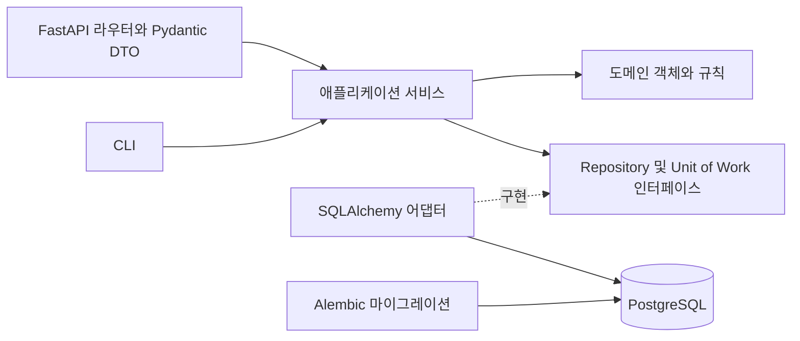

<div align="center">

# 백엔드 개발 인턴십 포트폴리오

[English](README.md) · **한국어**

**테스트 가능한 숫자 야구 게임에서 주문과 재고를 트랜잭션으로 관리하는 백엔드까지.**

Python · 도메인 모델링 · REST API · 데이터 무결성

[프로젝트](#프로젝트) · [배운 점](#배운-점) · [피드백과 회고](docs/FEEDBACK.ko.md) · [아키텍처](#시스템-아키텍처) · [로컬 실행](#로컬-실행) · [로드맵](#향후-개발-로드맵)

</div>

## 기술 스택

**언어 및 API**


**데이터베이스 및 영속화**


**개발 및 테스트**


## 개요

인턴십에서 숫자 야구 게임을 만들고, 주문·모의 결제·공유 재고를 처리하는 카페 키오스크 백엔드로 범위를 넓혔습니다. 두 과제를 수행하며 실패 입력을 고려하는 법, 업무 규칙을 도메인에 표현하는 법, 여러 데이터 변경을 하나의 트랜잭션으로 묶는 법을 배웠습니다.

> **인턴십 당시 구현과 종료 후 작업**
>
> 아래 기능은 인턴십 당시 구현에 포함되어 있습니다. 인턴십 종료 후에는 기술 문서와 저장소를 포트폴리오로 정리했습니다. 인증, 웹 화면, 추가 보안 작업은 향후 계획입니다.

[인턴십 원본 태그](https://github.com/jisung1017/internship/tree/v1.0.0-internship) · [기준 커밋 `dc8c5c0`](https://github.com/jisung1017/internship/commit/dc8c5c02b164a66e193457e8ff90a703a1f756bc) · 2026년 8월 20일

## 프로젝트

### 01 · 숫자 야구 게임

**Python / 객체지향 설계 / 입력 검증 / CLI / Pytest**

서로 다른 숫자 세 개를 일곱 번 안에 맞히는 게임입니다. 콘솔 입출력과 입력 검증, 스트라이크·볼 판정을 나눠 각 동작을 따로 테스트할 수 있게 했습니다.

알고리즘 문제를 풀듯 `main()`부터 작성하다 보니 잘못된 입력과 재시도 흐름을 놓치기 쉬웠습니다. 어떤 입력이 실패해야 하는지부터 테스트로 정의하는 습관이 필요하다는 점을 배웠습니다.

[프로젝트 및 회고 (영문)](assignments_1/README.md) · [구현 코드](assignments_1/number_baseball.py) · [테스트](assignments_1/test_baseball.py)

### 02 · 카페 키오스크 백엔드 (대표 프로젝트)

**FastAPI / PostgreSQL / SQLAlchemy / Alembic / Docker Compose / Pytest / uv**

음료 옵션, 주문, 재고, 주문 취소, 관리자 조회를 처리하는 백엔드입니다. CLI에서 시작해 도메인 객체와 애플리케이션 유스케이스를 활용하는 REST API로 확장했습니다.

CLI를 만든 뒤에야 옵션도 재료를 소비한다는 요구를 발견해 모델과 테스트를 다시 손봤습니다. 설계 전에 메뉴 선택부터 결제와 재고 차감까지 한 주문의 흐름을 따라갔다면 이 요구를 더 일찍 발견할 수 있었습니다.

[프로젝트 및 회고 (영문)](assignments_2/README.md) · [아키텍처 및 ERD (영문)](assignments_2/docs/ARCHITECTURE.md) · [소스](assignments_2/src/) · [테스트](assignments_2/tests/)

## 배운 점

인턴십 노트와 코드 리뷰를 바탕으로 정리했습니다. 구현과 테스트 링크는 인턴십 기준 버전의 변경을 보여줍니다.

당시 어떤 피드백을 받았고, 제가 어떻게 받아들여 무엇을 바꿨는지 따로 정리했습니다. [피드백과 회고](docs/FEEDBACK.ko.md)

| 겪은 문제 | 적용한 내용 | 배운 점 |
| --- | --- | --- |
| 숫자 야구 첫 구현이 정상 입력의 판정에 치우쳤습니다 | [입력 검증](assignments_1/number_baseball.py)을 분리하고 [실패 및 재시도 테스트](assignments_1/test_baseball.py)를 추가했습니다 | 구현 전에 특정 동작을 검증하는 실패 테스트를 작성합니다 |
| 초기 주문 모델에서 옵션이 소비하는 재료를 놓쳤습니다 | [주문 재료 요구량](assignments_2/src/domain/cart_item.py)에 메뉴와 옵션 레시피를 포함하고 [옵션 재고 차감 인수 테스트](assignments_2/tests/test_acceptance.py)를 추가했습니다 | 도메인 모델을 정하기 전에 주문의 전체 흐름을 따라갑니다 |
| API 리뷰에서 요청 사이에 장바구니를 누가 관리해야 하는지 피드백을 받았습니다 | [주문 서비스](assignments_2/src/application/order_application_service.py)가 요청으로 받은 주문 항목으로 매번 장바구니를 구성하도록 했습니다 | 고객의 주문 흐름에서 출발해 서버에 필요한 상태를 정합니다 |
| Alembic 리비전을 교체하면서 이전 체크아웃에서의 업그레이드 경로가 끊겼습니다 | 기준 버전에는 [연결된 리비전 체인](assignments_2/migrations/versions/)이 있습니다 | 마이그레이션 이력을 보존하고 기존 스키마에서 업그레이드되는지 확인합니다 |

### 다음 개발에서 실천할 일

- 사용자 흐름을 먼저 그려 보고 인수 시나리오를 작성한 뒤, 세부 도메인 테스트로 나눕니다.
- 입력 검증을 구현하기 전에 정상 범위의 양 끝값과 바로 바깥 값, 빈 값이나 0처럼 의미 있는 특수값을 정리합니다.
- 변경 하나를 확인한 뒤 그 의도가 담긴 작은 커밋을 남깁니다.
- API 요청이 서비스와 DB를 거치는 경로를 따라가고, 트랜잭션이 어디서 끝나는지 설명할 수 있게 합니다.

## 대표 프로젝트 · 카페 키오스크 백엔드

메뉴 조회와 옵션 선택, 주문 접수와 조회, 입고, 주문 취소에 따른 재고 복구, 재고 이력과 일일 매출 조회를 지원합니다. CLI와 REST API는 애플리케이션 서비스와 도메인 객체를 공유합니다.

주문에 필요한 재료를 합산해 재고를 검증하고, 주문 기록·재고 변경·재고 이력을 하나의 DB 트랜잭션으로 저장합니다.

## 시스템 아키텍처



API와 CLI는 동일한 유스케이스를 사용합니다. Repository와 Unit of Work 인터페이스가 애플리케이션의 처리 흐름과 영속화 구현을 연결합니다. 계층 사이의 의존성과 현재 설계의 절충점은 아키텍처 문서에 설명했습니다. [아키텍처와 의존성 경계 (영문)](assignments_2/docs/ARCHITECTURE.md#layers-and-dependency-boundaries)

## 주요 설계와 구현

| 주제 | 인턴십 당시 구현 | 소스 |
| --- | --- | --- |
| 도메인 모델링 | 금액·수량 값 객체와 메뉴, 옵션 그룹, 레시피, 장바구니, 재고 모델 | [도메인](assignments_2/src/domain/) |
| 트랜잭션 경계 | 서비스가 명시적으로 커밋하고, Repository는 Unit of Work에서 같은 세션을 사용 | [Unit of Work](assignments_2/src/infrastructure/unit_of_work.py) |
| 동시 재고 변경 | 재료 ID 오름차순으로 트랜잭션 수준 advisory lock을 얻고, 잠금을 얻은 범위의 재고만 저장 | [재고 Repository](assignments_2/src/infrastructure/repositories/orm_inventory_repository.py) |
| 주문 재시도 | 선택적인 UUID `Idempotency-Key`, 주문 UUID 고유 제약, 동시 삽입 충돌 시 롤백 후 재조회 | [주문 서비스](assignments_2/src/application/order_application_service.py) |
| 이력 | 주문 시 메뉴와 옵션의 이름·가격을 스냅샷으로 저장하고 재고 변동 사유를 기록 | [ORM 모델](assignments_2/src/infrastructure/models.py) |
| 테스트 | 도메인·애플리케이션 테스트, 대역을 사용한 API 및 CLI 시나리오, SQLite Repository 테스트, 별도 DB를 사용하는 PostgreSQL 동시성 테스트 | [테스트 안내 (영문)](assignments_2/README.md#testing-strategy) |

인증과 데이터 정합성의 제약, 테스트 환경별 검증 범위는 상세 문서에서 확인할 수 있습니다. [알려진 한계 (영문)](assignments_2/README.md#known-limitations)

## 개발 타임라인

| 시기 | 작업 범위 | 상태 |
| --- | --- | --- |
| 2026년 6~8월 · 인턴십 | 숫자 야구, 키오스크 도메인과 CLI, FastAPI·ORM 연동, Unit of Work, 마이그레이션, 동시성 제어, 재고 이력 | 원본 태그에 보존 |
| 인턴십 종료 후 · Phase 0 | 포트폴리오 문서, 소스 기반 아키텍처 설명, 저장소 정리 및 공개 범위 점검 | 포트폴리오 정리 |
| 인턴십 종료 후 · Phase 1~4 | 인증, 웹 화면, 보안 및 데이터 보호, 통합과 릴리스 | 향후 계획 |

## 저장소 구조

```text
internship/
├── assignments_1/          # 숫자 야구 구현 및 테스트
│   └── example/            # 참고 예제
├── assignments_2/          # 카페 키오스크 백엔드
│   ├── src/
│   │   ├── domain/
│   │   ├── application/
│   │   ├── infrastructure/
│   │   └── interface/      # CLI와 FastAPI
│   ├── tests/
│   ├── migrations/
│   ├── data/               # 로컬 시드 데이터
│   ├── docs/               # 기술 문서 및 당시 학습 자료
│   └── scripts/
├── example_2/               # 별도의 참고 구현
├── assignment-template/    # 원본 과제 템플릿
├── docs/                   # 한국어·영문 피드백과 회고
├── .gitignore
├── README.md                # 영문 포트폴리오
└── README.ko.md             # 한국어 포트폴리오
```

참고 예제, 과제 가이드, 리뷰 문서는 학습 자료입니다. 기존 디렉터리 경로를 유지해 실행 방법과 과거 커밋의 링크를 따라갈 수 있습니다.

## 로컬 실행

키오스크를 실행하려면 Python 3.14, uv, Docker Compose가 필요합니다. Compose로 **PostgreSQL**을 띄우고, API는 호스트에서 실행합니다. DB가 준비된 뒤 마이그레이션을 실행하세요.

```bash
git clone https://github.com/jisung1017/internship.git
cd internship/assignments_2
uv sync --frozen
docker compose up -d postgres
uv run alembic upgrade head
uv run python scripts/seed.py
uv run uvicorn src.interface.api.app:app --host 127.0.0.1 --port 8000
```

`http://127.0.0.1:8000/docs`에서 API 문서를 확인할 수 있습니다. 저장소의 DB 연결 값은 로컬 개발용 기본값입니다. 다른 DB를 사용할 때는 셸에서 환경변수를 설정해야 하며, Python이 `.env` 파일을 자동으로 읽지 않습니다. 마이그레이션이나 DB 테스트 전에는 상세 실행 안내의 검증 범위와 테스트 격리 요구사항을 확인하세요. [키오스크 실행 안내 (영문)](assignments_2/README.md#getting-started)

숫자 야구는 `assignments_1/`에서 `python number_baseball.py`로 실행합니다. [숫자 야구 실행 및 테스트 안내 (영문)](assignments_1/README.md#getting-started)

## 향후 개발 로드맵

인증, 사용자 화면, API 보안, 데이터 보호에 관한 피드백을 바탕으로 기존 백엔드를 확장할 계획입니다. 기술 선택은 구현 시점에 검토합니다.

| 단계 | 범위 |
| --- | --- |
| **0 · 포트폴리오 준비** | 인턴십 원본 보존, 문서 개선, 공개 자료 및 저장소 상태 점검 |
| **1 · 인증 및 인가** | OAuth 2.0 / OpenID Connect와 Google Identity 검토, 관리자 역할과 토큰·세션 설계, 인가 테스트 |
| **2 · 웹 인터페이스** | React와 TypeScript 적용 검토, 고객 주문 화면과 주문·재고·매출 관리자 화면 |
| **3 · 보안 및 데이터 보호** | 비밀 값 관리, CORS 범위 설정, 요청 제한, 접근 제어, 개인정보 최소 수집, 로그 마스킹, 관리자 감사 로그, 보안 테스트 |
| **4 · 통합 및 릴리스** | API·UI·DB의 Compose 통합, GitHub Actions CI, 통합·동시성·보안 검증, 데모 문서화 및 릴리스 |

인턴십 버전은 신뢰할 수 있는 로컬 개발 환경에서 실행하세요.
