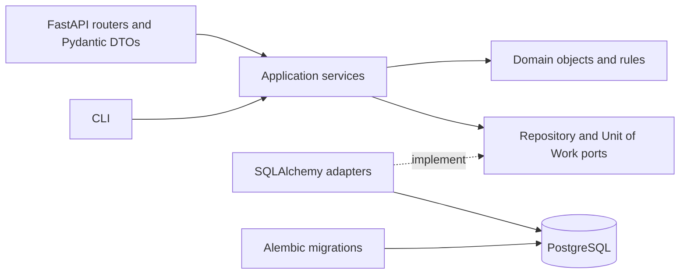

<div align="center">

# Backend Engineering Internship

**English** · [한국어](README.ko.md)

**From a testable CLI game to a transactional cafe backend.**

Python · Domain Modeling · REST APIs · Data Integrity

[Projects](#projects) · [What I Learned](#what-i-learned) · [Feedback & Reflections](docs/FEEDBACK.md) · [Architecture](#system-architecture) · [Run Locally](#getting-started) · [Roadmap](#future-development-roadmap)

</div>

## Tech Stack

**Language & API**


**Database & Persistence**


**Development & Testing**


## Overview

During this internship, I progressed from writing a small guessing game to building a backend that coordinates orders, simulated payments, and shared inventory. The assignments taught me to think beyond the successful path: validate input, model business rules explicitly, and define how changes should succeed or fail together.

> **Internship → Post-Internship**
>
> The application features described here belong to the internship baseline. Current post-internship work improves documentation and repository presentation. Authentication, a web interface, and further security work are planned.

[Original internship tag](https://github.com/jisung1017/internship/tree/v1.0.0-internship) · [Baseline commit `dc8c5c0`](https://github.com/jisung1017/internship/commit/dc8c5c02b164a66e193457e8ff90a703a1f756bc) · August 20, 2026

## Projects

### 01 · Number Baseball Game

**Python / Object-Oriented Design / Input Validation / CLI / Pytest**

A three-digit guessing game with seven attempts. I separated console interaction, validation, and strike/ball rules so each responsibility could be exercised independently.

**Key lesson:** I caught myself writing `main()` first, as I would for an algorithm exercise. That habit made it easy to overlook malformed guesses and retries when defining what the program should do.

[Project & retrospective](assignments_1/README.md) · [Implementation](assignments_1/number_baseball.py) · [Tests](assignments_1/test_baseball.py)

### 02 · Cafe Kiosk Backend — Featured

**FastAPI / PostgreSQL / SQLAlchemy / Alembic / Docker Compose / Pytest / uv**

A backend for configurable cafe orders, inventory, cancellation, and administrative queries. The project grew from a CLI into a REST API while preserving its domain objects and application use cases.

**Key lesson:** I caught the option stock requirement after building the CLI. Tracing a complete order earlier would have exposed it before I had to revise the model and its tests.

[Project & retrospective](assignments_2/README.md) · [Architecture & ERD](assignments_2/docs/ARCHITECTURE.md) · [Source](assignments_2/src/) · [Tests](assignments_2/tests/)

## What I Learned

These lessons come from my internship notes and code reviews. The links point to changes and tests in the internship baseline.

For the original context behind these changes, read how I interpreted the feedback, what I implemented, and what I would do differently. [Feedback & Reflections](docs/FEEDBACK.md)

| Challenge | What I applied | What I learned |
| --- | --- | --- |
| My first game implementation focused on valid guesses | Separated [input validation](assignments_1/number_baseball.py) and added [failure and retry tests](assignments_1/test_baseball.py) | Write a failing test for a specific behavior before implementing it |
| Options consumed ingredients that the original checkout model missed | Included menu and option recipes in [order requirements](assignments_2/src/domain/cart_item.py) and added a [checkout scenario for option stock](assignments_2/tests/test_acceptance.py) | Walk through a complete order before settling the domain model |
| API review questioned who should own the cart between requests | The [order service](assignments_2/src/application/order_application_service.py) builds a fresh cart from the submitted order items | Start from the customer's checkout flow when deciding what state the server needs |
| Replacing an Alembic revision broke the upgrade path for earlier checkouts | The baseline contains a [linked revision chain](assignments_2/migrations/versions/) | Preserve migration history and verify upgrades from an existing schema |

### Commitments for the Next Iteration

- Sketch the full user flow and write an acceptance scenario before breaking it into focused domain tests.
- List valid boundaries, inputs just outside them, and relevant empty or zero values before implementing validation.
- Commit one purposeful, checked change at a time so a reviewer can follow the intent.
- Trace an API request from its payload through the service and database, and explain where the transaction ends.

## Featured Project — Cafe Kiosk Backend

The kiosk supports menu browsing, configurable options, order placement and lookup, stock replenishment, cancellation with inventory restoration, inventory history, and daily sales queries. A CLI and a REST API share application services and domain objects.

The engineering focus is the boundary between business rules and persistent state: an order validates aggregate ingredient requirements and persists its order records, stock changes, and inventory history within one database transaction.

## System Architecture



The API and CLI share the same use cases. Repository and Unit of Work ports separate application orchestration from persistence adapters. See the [architecture guide](assignments_2/docs/ARCHITECTURE.md#layers-and-dependency-boundaries) for the dependency boundaries and existing compromises.

## Engineering Highlights

| Concern | Existing implementation | Source |
| --- | --- | --- |
| Domain modeling | Money and quantity value objects; menus, option groups, recipes, carts, and inventory | [Domain](assignments_2/src/domain/) |
| Transaction boundaries | Services explicitly commit; repositories share a session through a Unit of Work | [Unit of Work](assignments_2/src/infrastructure/unit_of_work.py) |
| Concurrent stock changes | Transaction-level advisory locks in ascending ingredient ID order; saves restricted to the loaded lock scope | [Inventory repository](assignments_2/src/infrastructure/repositories/orm_inventory_repository.py) |
| Retry handling | Optional UUID `Idempotency-Key`, a unique order UUID, and rollback/re-query on an insert race | [Order service](assignments_2/src/application/order_application_service.py) |
| History | Menu and option names/prices stored as snapshots; inventory changes recorded with reasons | [ORM models](assignments_2/src/infrastructure/models.py) |
| Testing | Domain/application tests, fake-backed API and CLI scenarios, SQLite repository tests, and opt-in PostgreSQL concurrency tests | [Testing guide](assignments_2/README.md#testing-strategy) |

These are implementation characteristics, not throughput or production-readiness claims. See [known limitations](assignments_2/README.md#known-limitations).

## Development Timeline

| Period | Scope | Status |
| --- | --- | --- |
| June–August 2026 — Internship | Number Baseball; kiosk domain and CLI; FastAPI/ORM integration; Unit of Work; migrations; concurrency and inventory history | Preserved in the baseline tag |
| Post-Internship — Phase 0 | Portfolio documentation, source-based architecture descriptions, repository hygiene and publication review | Current preparation work |
| Post-Internship — Phases 1–4 | Identity, web interface, security/data protection, integration and release | Planned; not implemented |

## Repository Structure

```text
internship/
├── assignments_1/          # Number Baseball implementation and tests
│   └── example/            # Reference example, separate from the main implementation
├── assignments_2/          # Cafe Kiosk backend
│   ├── src/
│   │   ├── domain/
│   │   ├── application/
│   │   ├── infrastructure/
│   │   └── interface/      # CLI and FastAPI
│   ├── tests/
│   ├── migrations/
│   ├── data/              # Local seed data
│   ├── docs/              # Current architecture and historical learning documents
│   └── scripts/
├── example_2/              # Reference implementation, separate from featured work
├── assignment-template/   # Original assignment scaffold
├── docs/                  # Feedback and reflections in English and Korean
├── .gitignore
└── README.md
```

Reference examples, assignment guides, and review documents are learning materials rather than additional portfolio projects. Existing paths are retained so imports, execution commands, and historical links remain stable.

## Getting Started

For the kiosk, install Python 3.14, uv, and Docker with Compose. Compose starts **PostgreSQL only**; run the API on the host.

```bash
git clone https://github.com/jisung1017/internship.git
cd internship/assignments_2
uv sync --frozen
docker compose up -d postgres
uv run alembic upgrade head
uv run python scripts/seed.py
uv run uvicorn src.interface.api.app:app --host 127.0.0.1 --port 8000
```

Open `http://127.0.0.1:8000/docs` for generated API documentation. The checked-in database credentials are local development defaults. See [database setup, verification limits, and test isolation](assignments_2/README.md#getting-started) before running migrations or database tests. Environment variables must be set in the shell; the application does not automatically load `.env` files.

For the smaller CLI project, see [Number Baseball](assignments_1/README.md#getting-started).

## Future Development Roadmap

The following post-internship work extends the existing backend in response to feedback on identity, usability, API security, and data protection. Technology choices are provisional.

| Phase | Planned scope |
| --- | --- |
| **0 — Portfolio Preparation** | Preserve the baseline, improve documentation, review public content and repository hygiene |
| **1 — Authentication & Authorization** | Evaluate OAuth 2.0 / OpenID Connect and Google Identity; design administrator roles and token/session handling; add authorization tests |
| **2 — Web Interface** | Evaluate React + TypeScript; customer ordering flow and administrator views for orders, inventory, and sales |
| **3 — Security & Data Protection** | Secret management, scoped CORS, rate limiting, access control, minimal personal data, log masking, administrator audit logs, and security tests |
| **4 — Integration & Release** | API/UI/DB Compose integration, GitHub Actions CI, integration/concurrency/security verification, demo documentation, and a final release |

Authentication and production security controls are not present in the internship backend. Run the baseline in a trusted local development environment.
