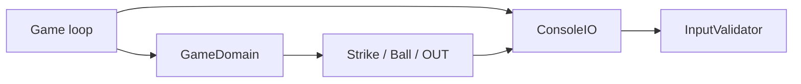

# Number Baseball Game


[Rules](#rules-and-features) · [Design](#design) · [Run](#getting-started) · [Retrospective](#retrospective)

A Python CLI guessing game developed during the internship. It demonstrates separation of console interaction, input validation, and game rules in a small, testable object-oriented program.

The original implementation is preserved at [v1.0.0-internship](https://github.com/jisung1017/internship/tree/v1.0.0-internship/assignments_1). This documentation is part of the post-internship portfolio preparation.

## Rules and Features

- Guess three distinct digits from **1 to 9** in the correct order.
- Enter digits separated by spaces, for example `1 2 3`.
- A **strike** is a matching digit in the matching position; a **ball** is a matching digit in another position. No matching digits produces `OUT`.
- The game allows seven valid guesses. Invalid input is retried within the current attempt.
- Three strikes wins; exhausting seven guesses reveals the answer.

## Design

| Component | Responsibility |
| --- | --- |
| [`InputValidator`](number_baseball.py) | Checks length, digit range, and uniqueness |
| [`ConsoleIO`](number_baseball.py) | Parses console input, retries invalid input, and prints results |
| [`GameDomain`](number_baseball.py) | Calculates strikes and balls without console I/O |
| [`main`](number_baseball.py) | Generates an answer and coordinates attempts and termination |



The domain compares matching positions and intersects digit sets. With a fixed three-digit game, this is a readability choice; no measured performance improvement is claimed.

## Getting Started

The runtime uses only the Python standard library. The kiosk project targets Python 3.14; this game has no separate Python version or dependency manifest.

```bash
cd assignments_1
python number_baseball.py
```

To test with uv and an isolated pytest dependency:

```bash
uv run --no-project --with pytest python -m pytest test_baseball.py -q
```

Alternatively, install pytest in your own virtual environment and run `python -m pytest test_baseball.py -q` from this directory.

## Testing Strategy

[`test_baseball.py`](test_baseball.py) covers validation errors, strike/ball combinations, invalid-input retries, attempt prompts, early wins, and defeat after seven attempts. Console input and random answer generation are patched so game-flow tests are deterministic. Parameterized invariant checks verify the relationship between strike/ball counts and matching digits; these do not use a property-testing library.

Use the explicit test file above to test the main implementation. [`example/`](example/) contains a separate reference implementation and its own tests; it is not included in claims about the main game's implementation.

## Retrospective

### What Changed in My Thinking

I caught myself writing `main()` first, as I would for an algorithm exercise. My first pass focused on scoring valid guesses. TDD gave me a way to start from a specific behavior, such as what should happen when the player enters a letter, repeats a digit, or runs out of guesses.

Pull request comments on my second iteration gave me concrete changes to work through. As I refactored, I began forming a rule for my own commits: finish and check one meaningful change, then write a message that helps a reviewer understand it.

### Lessons Applied in the Implementation

| Challenge | Applied response | Evidence |
| --- | --- | --- |
| Input parsing and validation had overlapping responsibilities | Extract `InputValidator` from console interaction | [Separation commit](https://github.com/jisung1017/internship/commit/e3a17a2) · [Current source](number_baseball.py) |
| The first pass focused on scoring valid guesses | Added cases for noninteger input, wrong length, duplicate digits, retries, early wins, and seven-attempt defeat | [Game-flow and validation tests](test_baseball.py) |
| Random answers made scenarios harder to reproduce | Patch answer generation and console input in tests | [Deterministic tests](test_baseball.py) |

The responsibility split is present, but the game loop still repeats validation after `ConsoleIO` validates input. This remains a small cleanup opportunity rather than a completed refactoring.

### What I Want to Carry Forward

- Write small tests with names that explain one behavior.
- Consider malformed input and boundary cases before the implementation.
- Start each new behavior with a failing test and make time for refactoring once it passes.
- Commit one meaningful change after checking that it works. Write the message for someone reviewing it later.

## Known Limitations

- CLI only; no persistence, score history, or web interface.
- Input/output messages mix Korean and English.
- Validation is repeated in the game loop after console validation.
- `GameDomain` expects already validated guesses; its constructor does not enforce the input contract.

These are properties of the preserved internship implementation. No gameplay behavior was changed during portfolio preparation.
