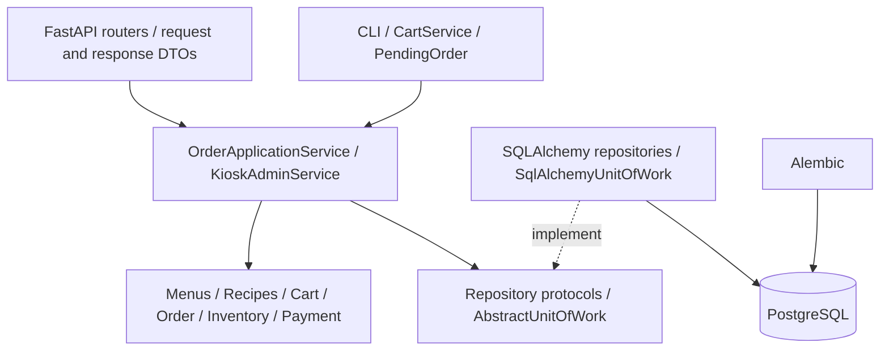

# Cafe Kiosk Backend


[Features](#features) · [Architecture & ERD](docs/ARCHITECTURE.md) · [API](#api-endpoints) · [Run](#getting-started) · [Retrospective](#retrospective)

A Python backend for configurable cafe orders, ingredient inventory, and administrative queries. The project evolved from a CLI into a FastAPI service while retaining its domain model and application use cases.

**Internship baseline:** [v1.0.0-internship](https://github.com/jisung1017/internship/tree/v1.0.0-internship/assignments_2), August 20, 2026. All features below exist in that baseline. This README and the current architecture guide are post-internship documentation; authentication and a browser UI are future work.

## Features

- Menu browsing with category/tag filters, pagination, option groups, prices, and stock-based availability.
- Orders with validated quantities and options, aggregated ingredient requirements, and simulated payment approval.
- UUID order lookup and an optional UUID idempotency key for order creation.
- Inventory queries, restocking, and paginated/filterable inventory history.
- Order status changes and cancellation with inventory restoration.
- Today's orders and sales totals (UTC day boundary; cancelled orders excluded from the total).
- A CLI and FastAPI routes using shared application services.

## Tech Stack

Python **3.14** (`requires-python >=3.14`, `.python-version` selects 3.14), FastAPI, Pydantic, SQLAlchemy 2, psycopg 3, PostgreSQL **17** in Compose, Alembic, Pytest, and uv. [`uv.lock`](uv.lock) pins the dependency versions. The package metadata still uses the original scaffold name `assignment-template`.

## System Architecture



- [`domain/`](src/domain/) contains business objects and validation rules.
- [`application/`](src/application/) coordinates use cases and defines repository and Unit of Work contracts.
- [`infrastructure/`](src/infrastructure/) maps domain objects to ORM records and implements persistence and transaction boundaries.
- [`interface/`](src/interface/) provides console interaction and HTTP parsing/serialization.
- [`src/main.py`](src/main.py) assembles the CLI; [`api/dependencies.py`](src/interface/api/dependencies.py) assembles API services.

The design follows Clean Architecture principles, with an existing exception: `OrderApplicationService` imports SQLAlchemy's `IntegrityError` to handle UUID insert races.

See [Architecture & ERD](docs/ARCHITECTURE.md) for the domain model, database relationships, order processing flow, concurrency control, idempotency, and transaction management. [Documentation index](docs/README.md) distinguishes current descriptions from historical guides and reviews.

## API Endpoints

Routes are defined in [`kiosk.py`](src/interface/api/routers/kiosk.py), [`admin.py`](src/interface/api/routers/admin.py), and [`app.py`](src/interface/api/app.py).

| Method | Path | Behavior |
| --- | --- | --- |
| GET | `/` | Welcome message |
| GET | `/api/v1/menus` | Filters: `category`, `tag`; `page >= 1`, `1 <= size <= 100` |
| POST | `/api/v1/orders` | Create an order; returns 201 and `Location` |
| GET | `/api/v1/orders/{order_uuid}` | Persisted order detail; 404 when absent |
| GET | `/api/v1/admin/orders` | Today's orders; optional `status` filter |
| PATCH | `/api/v1/admin/orders/{order_id}/status` | Update status using the numeric database ID |
| GET | `/api/v1/admin/inventory` | Current stock |
| POST | `/api/v1/admin/inventory/restock` | Add a positive quantity of an existing ingredient |
| GET | `/api/v1/admin/inventory/history` | Optional `ingredient_name`; pagination (default size 50, maximum 100) |
| GET | `/api/v1/admin/sales/today` | Non-cancelled sales total plus today's order records |

Order creation requires a UUID-valued **`X-Kiosk-UUID`** header. It is echoed as `client_uuid`, not persisted as an authenticated identity. **`Idempotency-Key`** is a separate, optional UUID header. Request items use `menu_name`, positive `quantity`, and `selected_option_ids` or `selected_options`; nonempty IDs take precedence over names. Inspect `/docs` and the menu response for valid option selections rather than assuming fixed seed IDs.

Out-of-stock failures return 409; handled business validation/payment failures return 400; FastAPI request validation returns 422. Administrator routes currently have no authentication or role checks.

## Getting Started

### Prerequisites

- Python 3.14 and uv.
- A running Docker engine with Compose, or a separately provisioned PostgreSQL instance.
- Run the following commands from `assignments_2/`.

### Local Database and API

```bash
uv sync --frozen
docker compose up -d postgres
# Wait until PostgreSQL is ready.
docker compose exec postgres pg_isready
uv run alembic upgrade head
uv run python scripts/seed.py
uv run uvicorn src.interface.api.app:app --host 127.0.0.1 --port 8000
```

Open `http://127.0.0.1:8000/docs` (Swagger UI), `/redoc`, or `/openapi.json`. The API does not migrate or seed the database on startup.

Compose starts PostgreSQL only, binds its port to `127.0.0.1:5432`, and persists data in a named volume. The host-side default connection in [`db.py`](src/infrastructure/db.py) matches the bundled local Compose configuration. These checked-in credentials are development examples, not production secrets.

For a different database, export `DATABASE_URL` **before** running the API, CLI, migration, or seed commands. Use your own connection values and avoid committing them. Both `postgresql://` and `postgresql+psycopg://` URLs are accepted by the SQLAlchemy entry points. `.env` files are not automatically loaded by Python; Compose's environment handling does not configure the host process. [`migrations/env.py`](migrations/env.py) chooses the environment variable or the application default rather than using the URL in `alembic.ini` as its final source.

Alembic revisions are the current migration path. [`001_init.sql`](migrations/001_init.sql) and `002_init.sql.disabled` are historical artifacts, not a second setup sequence. The JSON seed routine skips loading if a menu already exists; it is not a general reconciliation tool for partially populated databases.

**Verification limit:** fresh PostgreSQL migration/seed startup has not been verified during this documentation update. The latest migration adds non-null columns without backfilling existing rows, so upgrading a populated older schema needs review. Do not run these migrations against valuable data without a separate migration assessment.

### CLI

After preparing the database:

```bash
uv run python -m src.main
```

### Stop the Local Database

```bash
docker compose stop postgres
```

The named volume retains local data.

## Testing Strategy

| Layer | Existing tests | What they establish |
| --- | --- | --- |
| Domain | [`tests/domain/`](tests/domain/) | Value-object invariants, recipes, options, cart/order behavior, inventory changes |
| Application | [`tests/application/`](tests/application/) | Use-case orchestration and Unit of Work behavior with fakes |
| HTTP / CLI | [`tests/interface/`](tests/interface/), [`test_kiosk_order_api.py`](tests/test_kiosk_order_api.py), [`test_acceptance.py`](tests/test_acceptance.py) | DTOs, HTTP responses, and console scenarios; API dependencies are replaced with fake services |
| ORM | [`tests/infrastructure/`](tests/infrastructure/) | Mapping and repository/transaction behavior using SQLite in memory |
| Concurrency | [`test_concurrency.py`](tests/test_concurrency.py) | PostgreSQL scenarios for stock contention, restock/order races, cancellation races, and duplicate UUID requests |

Run the suite that does not require a PostgreSQL server:

```bash
uv run pytest tests --ignore=tests/test_concurrency.py -q
```

API tests use the global dependency overrides in [`tests/conftest.py`](tests/conftest.py); they do not exercise real HTTP-to-PostgreSQL persistence. SQLite tests skip PostgreSQL advisory locks and row locks and cannot verify those mechanisms.

**Concurrency tests drop and recreate all ORM tables at the selected URL.** Use only an explicitly provisioned, disposable PostgreSQL test database and a test-only database account. Set `TEST_DATABASE_URL` to that database, then run:

```bash
uv run pytest tests/test_concurrency.py -q
```

The fixture prefers `TEST_DATABASE_URL`, falls back to `DATABASE_URL`, and skips only if no URL is set or it equals the built-in development default. It does not prove that another supplied URL is safe. The legacy `connection` fixture under `tests/infrastructure/conftest.py` also reads `DATABASE_URL` directly if requested.

These scenarios are correctness checks, not benchmarks. No throughput, latency, coverage percentage, or PostgreSQL pass result is claimed here.

## Retrospective

### Model the Requirement Before Extending the Code

After the first assignment, I felt more comfortable writing tests, but the kiosk exposed a different gap: I still tended to think about implementation before fully understanding the domain. I discovered during development that options also consume ingredients. That requirement affected entities, recipes, inventory calculations, and tests together.

The current model includes ingredient recipes for both menus and options. `CartItem` collects those requirements, and inventory validation checks their combined effect across an order. The acceptance suite includes a checkout that consumes an option's ingredients. That was the kind of scenario I wished I had written before modeling checkout. [Checkout acceptance tests](tests/test_acceptance.py)

### Design the API Around Checkout

The August API reviews made me revisit how the client places an order. I had largely exposed the CLI workflow through HTTP, and I struggled to explain how a request reached the database after the ORM migration. The feedback asked me to think through the customer journey, decide which state belonged to the client, and make the API understandable to someone using Swagger for the first time.

In the baseline, the API takes the complete set of order items in one request. The application service builds a cart for that request, and clients can select options by numeric ID. The menu endpoint exposes category and tag filters and a stock-based availability flag. [Order application service](src/application/order_application_service.py) · [Kiosk routes](src/interface/api/routers/kiosk.py) · [Request and response schemas](src/interface/api/schemas.py)

### Make the Whole Use Case Consistent

Moving from in-memory objects to a database made transaction boundaries concrete. Saving an order and updating inventory separately would leave room for partial results. The current Unit of Work lets application services commit order records, stock changes, and inventory history through a shared SQLAlchemy session.

Review feedback also pushed me to explain what a lock protects when several kiosks share inventory. The baseline uses transaction-level ingredient locks for stock updates and a row lock when changing an order's status. The PostgreSQL scenarios cover competing orders, restocks, and cancellations. [Concurrency tests](tests/test_concurrency.py)

### Preserve the Upgrade Path

During the internship I replaced an earlier Alembic revision and stamped my local database. That let me continue locally, but a database on the old revision could no longer follow the upgrade path. The baseline now has a linked revision chain. Compatibility with earlier databases still needs verification, especially when they already contain data. [Alembic revisions](migrations/versions/) · [Migration caveats](#getting-started)

### Improvements Visible in the Baseline

| Challenge | Applied response | Evidence |
| --- | --- | --- |
| Options affected both price and stock | Give option items recipes and include their requirements in the order | [Cart item](src/domain/cart_item.py) · [Checkout acceptance tests](tests/test_acceptance.py) |
| API review questioned who should own cart state and how clients should select options | Build a cart from each order request and accept numeric option IDs, with name-based selection still supported | [Application service](src/application/order_application_service.py) · [Cart service](src/application/cart_service.py) |
| Several repository writes needed one commit boundary | Introduce a shared-session Unit of Work | [Introduction commit](https://github.com/jisung1017/internship/commit/e2412dc) · [Transaction tests](tests/infrastructure/test_sqlalchemy_uow.py) |
| Concurrent stock updates needed coordination | Acquire ingredient advisory locks in a consistent order and restrict inventory saves to that scope | [Inventory repository](src/infrastructure/repositories/orm_inventory_repository.py) · [Concurrency scenarios](tests/test_concurrency.py) |

These responses address concrete parts of the design; the [known limitations](#known-limitations) describe cases they do not fully solve.

### Commitments for Future Work

- Sketch the full order flow and write an acceptance scenario before introducing or changing domain objects.
- Turn feedback about weak boundary tests into a checklist: test the minimum, maximum, neighboring values, and relevant empty, zero, or negative inputs.
- Trace a request from the route through the service and ORM, then document the expected payload and outcome so a reviewer can reproduce it.
- Preserve migration revisions and verify both a fresh setup and an upgrade from an earlier schema.

My next post-internship goals follow the feedback on authentication, a simple interface, API security, and data protection. Those are planned extensions, separate from the internship results above.

## Known Limitations

- **Access control:** no OAuth/OIDC, sessions, RBAC, or order ownership checks. `X-Kiosk-UUID` is not authentication. CORS currently permits all origins (credentials disabled); rate limiting, log masking, and administrator audit logging are not implemented.
- **Payment:** `Payment` is a boolean approval simulation. Database rollback cannot undo an external payment; there is no payment provider integration or compensation workflow.
- **Idempotency:** keys are optional, globally unique order UUIDs with no client scope or request fingerprint. Reuse with a different cart is not rejected; the POST response is rebuilt from the current cart. Use GET order detail for the persisted snapshot. Retries still validate the current menu/options before checking the stored UUID.
- **Cancellation:** ingredient restoration uses current catalog recipes (ID lookup with name fallback), not immutable recipe snapshots; missing catalog items can be skipped. Catalog changes could affect restoration accuracy.
- **Availability:** menu-list availability checks the base recipe for one serving. It does not guarantee stock for a particular quantity or option combination; checkout performs aggregate stock validation under locks. The API order path does not call `Menu.validate_orderable`, so the manual sold-out flag is not enforced there.
- **Consistency scope:** advisory locks coordinate cooperating repository writers. Direct SQL or another writer that ignores the same protocol can bypass them. Current ORM models do not declare nonnegative stock CHECK constraints.
- **Sales queries:** totals use a UTC day boundary. The total and order list are obtained in separate service calls and may differ during concurrent updates.
- **Operations:** Compose includes only the database. No browser UI, integrated deployment, or GitHub Actions CI exists yet. See migration and test isolation caveats above.

Authentication, a web UI, security/data protection, and final integration are [post-internship roadmap items](../README.md#future-development-roadmap). The Phase 0 documentation work does not change business logic, database schemas, or API behavior.
