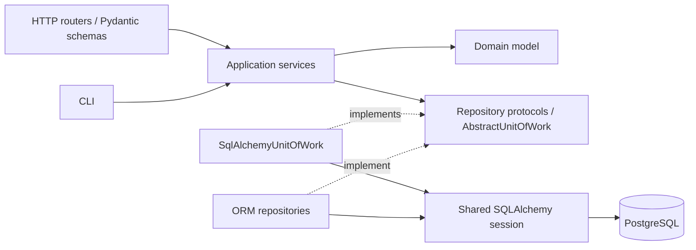
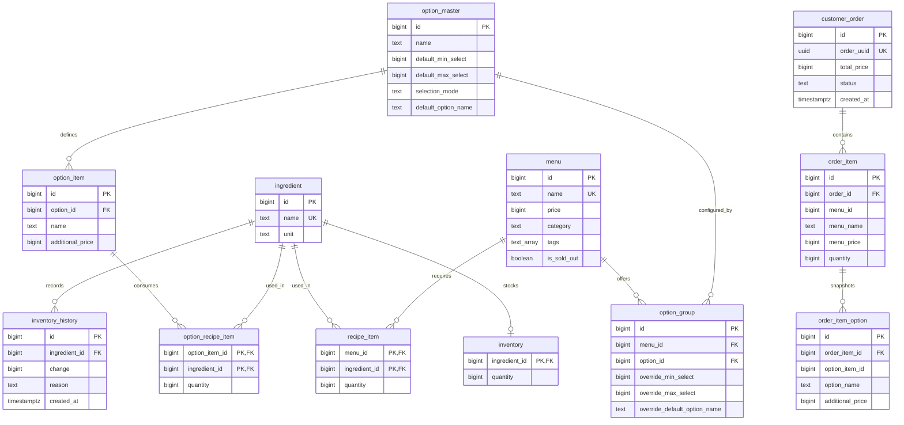
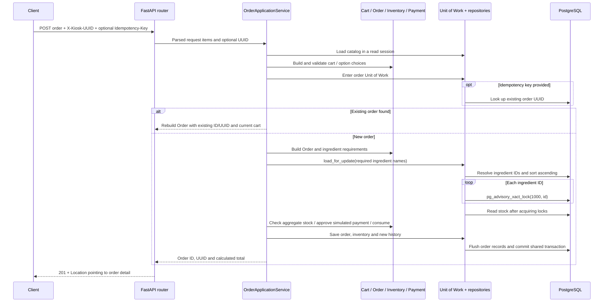

# Cafe Kiosk Architecture

This guide describes the implementation preserved at [v1.0.0-internship](https://github.com/jisung1017/internship/tree/v1.0.0-internship/assignments_2). The diagrams were prepared after the internship from the source; they do not represent new application features.

## Layers and Dependency Boundaries

The [API dependency module](../src/interface/api/dependencies.py) and [CLI composition root](../src/main.py) supply a session factory to `SqlAlchemyUnitOfWork`. Entering the Unit of Work creates a session and menu, inventory, and order repositories using that session. Services decide when to commit; repositories query, map, add, and flush records without committing.

The domain does not import FastAPI or SQLAlchemy. The application uses persistence contracts, but [`OrderApplicationService`](../src/application/order_application_service.py) also imports SQLAlchemy's `IntegrityError`. This is a concrete dependency at the application boundary, rather than complete framework isolation.

## Domain Model

| Object | Role and collaboration |
| --- | --- |
| [`Money`](../src/domain/money.py), [`Quantity`](../src/domain/quantity.py) | Wrap integer prices/quantities and validate their invariants |
| [`Ingredient`](../src/domain/ingredient.py), [`Recipe`](../src/domain/recipe.py), [`RecipeItem`](../src/domain/recipe_item.py) | Describe ingredients consumed by menus/options |
| [`Menu`](../src/domain/menu.py) | Price, recipe, category/tags, manual sold-out state, option lookup/validation |
| [`Option`](../src/domain/option.py), [`OptionGroup`](../src/domain/option_group.py), [`OptionItem`](../src/domain/option_item.py) | Reusable option definitions, per-menu selection overrides, additional prices and recipes |
| [`Cart`](../src/domain/cart.py), [`CartItem`](../src/domain/cart_item.py) | Selected menus, quantities, and option choices |
| [`Order`](../src/domain/order.py) | Order items, UUID, total price, and recipe requirements |
| [`Payment`](../src/domain/payment.py) | Simulated approval or payment failure; no payment gateway |
| [`Inventory`](../src/domain/inventory.py), [`InventoryItem`](../src/domain/inventory_item.py) | Validate aggregate requirements and apply stock changes |
| [`InventoryHistory`](../src/domain/inventory_history.py) | Ingredient change, reason, timestamp, and optional persisted ID |
| [`OrderRecord`](../src/domain/order_record.py) | Persisted order read model with item/option snapshots |

`CartService` translates menu/option names or IDs into domain objects. `OrderApplicationService` handles ordering and menu queries. `KioskAdminService` handles inventory, sales, order status changes, and cancellation restoration.

## Database ERD

The following diagram follows [`infrastructure/models.py`](../src/infrastructure/models.py), including its declared foreign keys. Alembic revisions under [`migrations/versions/`](../migrations/versions/) construct and evolve the schema; this diagram is not a claim that a live database has been inspected.

- `recipe_item` and `option_recipe_item` use composite primary keys. `option_group` has a unique `(menu_id, option_id)` constraint.
- `inventory.ingredient_id` is both its primary key and its ingredient foreign key.
- `customer_order.order_uuid` is unique and non-null. The optional idempotency key becomes this UUID; otherwise `Order` generates one (the repository also has a UUID fallback).
- `order_item.menu_id` and `order_item_option.option_item_id` are nullable identifiers **without catalog foreign keys**. Names and prices are copied into the order records so historical prices can be read independently of current catalog prices.
- Inventory reasons written by current flows are `CONSUME`, `RESTOCK`, and `CANCEL`; history is not a general administrator audit log.
- The ORM has no nonnegative quantity CHECK constraint. Domain validation and the locking protocol carry the stock invariant for these application flows. The old SQL artifact must not be used to infer constraints in the current migration path.

## Order Processing Flow

The order contains the combined menu and selected-option requirements for every line and quantity. `Inventory.can_consume_all` checks the aggregate, so two lines sharing an ingredient are not validated independently against the same stock. A failure rolls back database changes through the Unit of Work. The normal new-order path clears the cart in a `finally` block; the existing-order path also clears it.

## Concurrency Control

[`OrmInventoryRepository.load_for_update`](../src/infrastructure/repositories/orm_inventory_repository.py) uses **transaction-level advisory locks**, despite the method name suggesting a row lock:

1. Deduplicate requested ingredient names and resolve their database IDs.
2. Reject requests containing an unknown ingredient.
3. Acquire `pg_advisory_xact_lock(1000, id)` for each ingredient in ascending ID order.
4. Read the requested inventory after lock acquisition, returning an inventory object marked with its loaded lock scope.
5. Reject saves without that scope or containing an ingredient outside it. Save quantities and only newly accumulated history entries.

Namespace `1000` separates these two-integer advisory keys from other uses of the lock API. Transaction completion releases the locks. Consistent ingredient ordering reduces deadlock risk among cooperating writers; it is not a guarantee against every possible database deadlock. SQLite skips the advisory-lock calls.

Restock and cancellation use the same inventory repository path as checkout. Cancellation first obtains a PostgreSQL `SELECT ... FOR UPDATE` lock on the order row through [`find_by_id_for_update`](../src/infrastructure/repositories/orm_order_repository.py). It then checks status, restores required ingredients, and changes the order status in one transaction. A competing cancellation reads the updated status after waiting and is rejected if the order is already cancelled.

These are cooperative locks. Another SQL writer that ignores this protocol is outside its protection. Cancellation also reconstructs ingredients from the **current catalog**, which limits correctness if recipes or catalog entries change after purchase.

## UUID Idempotency

[`place_order`](../src/application/order_application_service.py) first checks the optional UUID and returns an existing order identity if found. On a new order it attempts a unique `customer_order.order_uuid` insert. If persistence raises `IntegrityError`, it rolls back, queries that UUID again, and returns the existing order identity if found; otherwise it re-raises the error.

This prevents duplicate persisted UUIDs and rolls back the losing insert's database work, but it is not complete request replay protection:

- There is no payload hash, kiosk scope, expiry policy, or stored HTTP response.
- Reusing a key with different items is not rejected; the returned `Order` uses the new cart, so its POST total can differ from the stored record.
- Catalog/option validation occurs before the UUID lookup. A retry can fail if the current catalog no longer accepts the old request.
- A concurrent retry can fail stock validation before reaching the unique insert if the first request exhausted the stock.
- Without a key, separate requests create separate orders. `X-Kiosk-UUID` is only echoed by the router and is not the deduplication key.

Use `GET /api/v1/orders/{order_uuid}` to read the persisted order snapshot. The existing concurrency test for identical UUID requests checks returned UUID equality, rather than every inventory/history invariant or every payload conflict case.

## Transaction Management

[`SqlAlchemyUnitOfWork`](../src/infrastructure/unit_of_work.py) creates and closes the session. [`AbstractUnitOfWork`](../src/application/unit_of_work.py) requests rollback on exceptions; services commit successful writes explicitly. Read-only sessions are closed without a commit. Order inserts may flush to obtain generated IDs before commit, but that flush does not commit the transaction.

| Use case | Database changes committed together |
| --- | --- |
| Place order | Order/items/options, affected stock quantities, `CONSUME` history |
| Restock | Affected stock quantity and `RESTOCK` history |
| Cancel order | Order status, restored stock quantities, `CANCEL` history |

`Payment.pay` only checks an in-memory approval flag. Database atomicity does not imply atomic settlement with an external payment provider. Such an integration would need a separate design.

For setup, test commands, migration caveats, and other known limitations, return to the [project README](../README.md).
